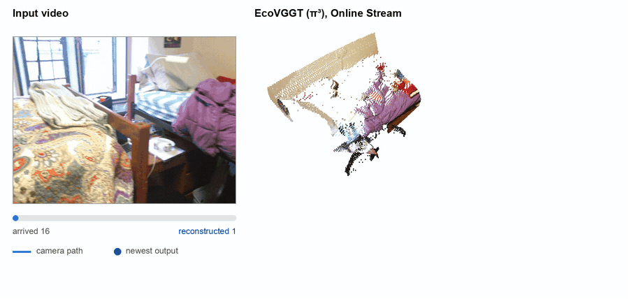
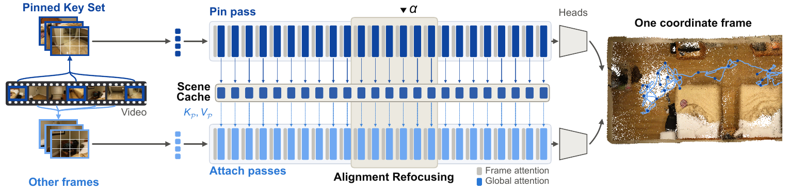
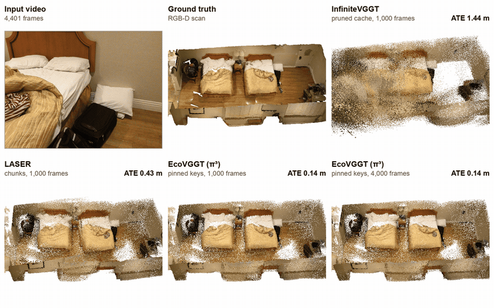
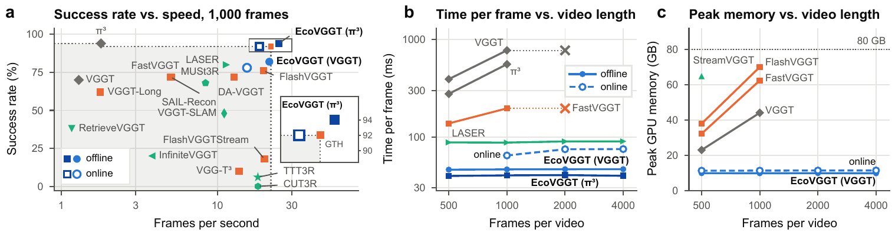

<div align="center">

<h1>EcoVGGT: Pinned-Key Inference for Efficient and Streamable<br>Feed-Forward 3D Reconstruction from Long Videos</h1>

Hongsen Cao&ensp;·&ensp;Shanxin Yuan&ensp;·&ensp;Mona Jaber&ensp;·&ensp;Ahmed Sayed

Queen Mary University of London

<a href="https://arxiv.org/abs/XXXX.XXXXX"></a>
<a href="https://huggingface.co/Tequila7437/EcoVGGT"></a>
<a href="LICENSE"></a>
<a href="https://creativecommons.org/licenses/by-nc/4.0/"></a>



<i>EcoVGGT (π³) reconstructs a 1,000-frame ScanNet video while the frames arrive.</i>

</div>

## News

- **2026-11**: Code, Alignment Refocusing weights, and paper released.

<details>
<summary><b>Contents</b></summary>

[Overview](#overview) · [Results](#results) · [Installation](#installation) · [Quick start](#quick-start) · [Backbones](#backbones) · [Online Stream](#online-stream) · [Alignment Score](#alignment-score) · [Evaluation](#evaluation) · [Training](#training-alignment-refocusing) · [Model weights](#model-weights) · [Citation](#citation) · [License](#license)

</details>

## Overview

VGGT and similar feed-forward models reconstruct a video in a single pass, but their cross-frame self-attention grows quadratically with the number of frames, and their accuracy drops on long videos. In EcoVGGT, every frame attends to the same 31 frames, spread evenly over the video. We call these frames the Pinned Key Set. A pin pass caches their tokens in a Scene Cache, and the remaining frames read this cache in independent batches. The result equals joint inference with these keys up to floating-point rounding, while the cost per frame and the peak memory stay constant as the video grows. The Online Stream applies the same idea while a video is still being recorded.

Global blocks 10 to 15 of VGGT align the frames. The Alignment Score reads their attention to flag likely failures without training or ground truth. Alignment Refocusing fine-tunes only these six blocks (76M parameters, 3.6 GPU hours) and reduces the failures. EcoVGGT runs on VGGT, π³, VGGT-Ω, and Depth Anything 3 (DA3), and each version carries the name of its backbone.

<p align="center"></p>

## Results

On 1,000-frame ScanNet videos, EcoVGGT (π³) keeps the success rate of π³ and runs 13.8 times as fast, where success means an absolute trajectory error (ATE) below 0.2 m. On 500 frames, EcoVGGT (VGGT) with Alignment Refocusing raises the success rate of VGGT from 70% to 82% and runs 8.5 times as fast. EcoVGGT reconstructs 4,000 frames on one GPU, and EcoVGGT (π³) streams 1,000 frames at 18.6 frames per second.

<div align="center">
<table>
<thead>
<tr><th rowspan="2" align="left">Method</th><th colspan="4">500 frames</th><th colspan="4">1,000 frames</th></tr>
<tr><th>Success (%)</th><th>ATE (m)</th><th>Time (s)</th><th>Memory (GB)</th><th>Success (%)</th><th>ATE (m)</th><th>Time (s)</th><th>Memory (GB)</th></tr>
</thead>
<tbody>
<tr><td>VGGT</td><td align="center">70</td><td align="center">0.111</td><td align="center">196</td><td align="center">23.1</td><td align="center">70</td><td align="center">0.130</td><td align="center">772</td><td align="center">44.2</td></tr>
<tr><td>EcoVGGT (VGGT)</td><td align="center">82</td><td align="center">0.090</td><td align="center">23.1</td><td align="center">10.0</td><td align="center">82</td><td align="center">0.093</td><td align="center">46.5</td><td align="center">10.0</td></tr>
<tr><td>EcoVGGT (VGGT), online</td><td align="center">78</td><td align="center">0.102</td><td align="center">45.8</td><td align="center">11.4</td><td align="center">78</td><td align="center">0.099</td><td align="center">64.6</td><td align="center">11.5</td></tr>
<tr><td>π³</td><td align="center">94</td><td align="center">0.054</td><td align="center">138</td><td align="center">24.4</td><td align="center">94</td><td align="center">0.058</td><td align="center">557</td><td align="center">43.4</td></tr>
<tr><td>EcoVGGT (π³)</td><td align="center">94</td><td align="center">0.052</td><td align="center">19.9</td><td align="center">9.9</td><td align="center">94</td><td align="center">0.060</td><td align="center">40.4</td><td align="center">9.9</td></tr>
<tr><td>EcoVGGT (π³), online</td><td align="center">90</td><td align="center">0.061</td><td align="center">37.0</td><td align="center">11.0</td><td align="center">92</td><td align="center">0.061</td><td align="center">53.8</td><td align="center">11.0</td></tr>
</tbody>
</table>
</div>

These rows come from Table 1 of the paper, which also covers 16 other methods. Each length has 50 ScanNet videos, and every method ran on one A100 GPU with 80 GB. Time is the median per video. Memory is the peak of inference over the videos, without the input frames.

<p align="center"></p>

<i>A 4,401-frame ScanNet video seen from above, with the ceiling removed. InfiniteVGGT misplaces the walls, while EcoVGGT (π³) keeps every wall in place at 1,000 and 4,000 frames.</i>

<p align="center"></p>

<i>Success rate against speed at 1,000 frames, and time per frame and peak memory against video length.</i>

## Installation

```bash
git clone https://github.com/Tequila7437/EcoVGGT.git
cd EcoVGGT
conda create -n ecovggt python=3.10 -y
conda activate ecovggt
pip install torch torchvision --index-url https://download.pytorch.org/whl/cu128
pip install -e .
bash scripts/setup_third_party.sh
```

The setup script clones FastVGGT and π³ into `third_party/` at the commits we used. We use the VGGT implementation of FastVGGT, as in the paper. A few parts need extra steps:

- DA3: `bash scripts/setup_third_party.sh da3` and `pip install -e third_party/Depth-Anything-3`
- VGGT-Ω: `bash scripts/setup_third_party.sh vggt-omega`, and accept the license on its [Hugging Face page](https://huggingface.co/facebook/VGGT-Omega) before the first download
- Training: `bash scripts/setup_third_party.sh vggt` for the VGGT training losses
- Evaluation: `pip install -e ".[eval]"`

We tested the code with Python 3.10 and PyTorch 2.11 on CUDA 12.8. The VGGT backbones run in bfloat16, which needs an NVIDIA GPU of the Ampere generation or newer.

## Quick start

```python
import ecovggt
from ecovggt.io import load_images

images = load_images("path/to/frames")   # [S, 3, H, W] in [0, 1], 518 pixels wide
model = ecovggt.load_backbone("pi3")     # or "vggt", "vggt-frozen", "da3", "vggt-omega"
rec = ecovggt.reconstruct(model, images.cuda(), "pi3")

rec["w2c"]           # [S, 3, 4] world-to-camera matrices (OpenCV), world = camera of frame 0
rec["intrinsics"]    # [S, 3, 3]
rec["depth"]         # [S, H, W], confidence in rec["conf"]
rec["world_points"]  # [S, H, W, 3]
```

`load_images` takes a folder of images, sorted by the numbers in their names, or a video file. For VGGT-Ω, call it with `backbone="vggt-omega"` to get the 416-pixel input of that model. Weights download on first use. To use local files, pass `weights=` and, for `"vggt"`, `refocusing_weights=` to `load_backbone`.

The demo writes the cameras (`cameras.json`), the depth maps (`depth.npz`), and a colored point cloud (`points.ply`):

```bash
python demo.py --input path/to/frames --backbone pi3 --out outputs/scene
python demo.py --input video.mp4 --stride 5 --backbone vggt --score --out outputs/video
python demo.py --input path/to/frames --backbone pi3 --online --key_interval 32 --out outputs/stream
```

## Backbones

| Name | Network | Offline | Online Stream | Alignment Score |
|---|---|:---:|:---:|:---:|
| `vggt` | VGGT-1B with Alignment Refocusing | yes | yes | yes |
| `vggt-frozen` | VGGT-1B with its released weights | yes | yes | yes |
| `pi3` | π³ | yes | yes | no |
| `da3` | DA3-LARGE | yes | no | no |
| `vggt-omega` | VGGT-Ω, 416-pixel checkpoint for benchmarking | yes | yes | no |

The VGGT backbones use bfloat16 weights. π³ and DA3 keep float32 weights and run under bfloat16 autocast, and VGGT-Ω follows its official forward pass. By default, 31 frames are pinned and the others are attached in batches of 64 (`num_keys` and `chunk` in `ecovggt.reconstruct`). The GPU memory of a pass depends on these two numbers only, not on the length of the video.

## Online Stream

The Online Stream takes frames one at a time. Every `key_interval` frames, the newest frame becomes a candidate key, and each pass pins up to `max_keys` candidates spread over the past. A frame is output `lag` passes after its interval, so it also sees up to `lag + 1` keys from later in the video. No frame waits longer than `(lag + 1) * key_interval` frames.

```python
stream = ecovggt.Pi3OnlineStream(model, key_interval=32, max_keys=32)
for image in frames:              # [3, H, W] in [0, 1] on the GPU
    emitted = stream.push(image)  # frames finished by this call
stream.finish()                   # flush the rest
out = stream.results()
```

`ecovggt.VGGTOnlineStream(model, key_interval, lag=2, max_keys=32)` has the same interface for the VGGT backbones. For VGGT-Ω, `ecovggt.vggt_omega_engine.online_reconstruct` runs the stream over a recorded clip. `demo.py --online` shows how to turn the outputs into cameras and points. In the paper, `key_interval` is 16 up to 500 frames and 32 beyond, `max_keys` is 32, and `lag` is 2 for VGGT and 0 for π³.

## Alignment Score

```python
model = ecovggt.load_backbone("vggt")
rec = ecovggt.reconstruct(model, images.cuda(), "vggt", score=True)
if rec["alignment_score"] < ecovggt.THRESHOLD_PINNED_KEYS:
    print("the reconstruction has likely failed")
```

The score is the 90th percentile of the divergence between each query's attention and the uniform distribution, over 2,048 random queries and all heads of global block 13 in the pin pass. It needs no training or ground truth, and it is ready before the first attach batch. Low values flag likely failures. For 500-frame ScanNet videos we use 9.09 with the Pinned Key Set and 7.83 with full attention, and the best threshold shifts on longer videos. The score works for the VGGT backbones and does not detect the failures of π³.

## Evaluation

Download the ScanNet `.sens` files after accepting the [terms of use](http://www.scan-net.org/), and export the 50 evaluation scenes:

```bash
python eval/prepare_scannet.py --sens_root /data/scannet/scans --scenes eval/scannet_50.txt \
    --out /data/scannet/process_scannet
```

Each of these commands evaluates one row of Table 1:

```bash
python eval/eval_scannet.py --data_dir /data/scannet/process_scannet --sens_root /data/scannet/scans \
    --backbone vggt --num_frames 500 --out results/vggt_500
python eval/eval_scannet.py --data_dir /data/scannet/process_scannet --sens_root /data/scannet/scans \
    --backbone pi3 --num_frames 1000 --online --out results/pi3_online_1000
```

Frames are sampled as in FastVGGT: the first frame, then every k-th frame with the largest k that fills the budget. The script saves the metrics of each scene and a summary with the success rate and the medians of the ATE, the relative rotation and translation errors (RPE-r and RPE-t), point accuracy and completeness, the absolute relative depth error (AbsRel), time, and peak memory. Point metrics use the predicted world points for π³ and DA3 and the unprojected depth maps for VGGT and VGGT-Ω, as in the paper. Without `--sens_root`, the script computes the trajectory metrics only, which is all the paper reports at 2,000 and 4,000 frames besides time and memory. Our timings come from A100 GPUs with 80 GB. Other GPUs can give slightly different metrics, because their bfloat16 kernels differ.

## Training Alignment Refocusing

```bash
bash scripts/setup_third_party.sh vggt
python eval/prepare_scannet.py --sens_root /data/scannet/scans --scenes training/scannet_train_195.txt \
    --out /data/scannet/process_scannet_train --train
python training/train_refocusing.py --data_dir /data/scannet/process_scannet_train \
    --scenes training/scannet_train_195.txt --weights /path/to/VGGT-1B/model.pt --out runs/refocusing
```

The 195 training scans are the first scans of ScanNet rooms that are not among the evaluation scenes. Each step takes a whole scan or a random contiguous half of it, pins 24 evenly spaced frames, and adds 24 random frames that attend only to the pinned ones. The loss is the camera loss of VGGT on all frames plus its depth loss on six of them. Our weights come from 2,000 AdamW steps at a learning rate of 1e-5, which took 3.6 hours on one A100 GPU and 37 GB of memory. To load your own checkpoint, call `ecovggt.load_backbone("vggt", refocusing_weights="runs/refocusing/alignment_refocusing_step2000.safetensors")`.

## Model weights

The Alignment Refocusing weights (`alignment_refocusing_vggt1b.safetensors`, 302 MB) replace global blocks 10 to 15 of VGGT-1B and hold 75.6M parameters. They are on [Hugging Face](https://huggingface.co/Tequila7437/EcoVGGT), and `ecovggt.load_backbone("vggt")` downloads them together with VGGT-1B. The other backbones use the weights released by their authors.

## Citation

```bibtex
@article{cao2026ecovggt,
  title   = {{EcoVGGT}: Pinned-Key Inference for Efficient and Streamable Feed-Forward {3D} Reconstruction from Long Videos},
  author  = {Cao, Hongsen and Yuan, Shanxin and Jaber, Mona and Sayed, Ahmed},
  journal = {arXiv preprint arXiv:XXXX.XXXXX},
  year    = {2026}
}
```

## Acknowledgements

EcoVGGT builds on [VGGT](https://github.com/facebookresearch/vggt), [FastVGGT](https://github.com/mystorm16/FastVGGT), [π³](https://github.com/yyfz/Pi3), [VGGT-Ω](https://github.com/facebookresearch/vggt-omega), and [Depth Anything 3](https://github.com/ByteDance-Seed/Depth-Anything-3), and its evaluation uses [ScanNet](http://www.scan-net.org/), [evo](https://github.com/MichaelGrupp/evo), and [Open3D](https://www.open3d.org/). We thank their authors for making them public.

## License

The code derives from VGGT and is released under the [VGGT License](LICENSE). Files adapted from π³, Depth Anything 3, and VGGT-Ω keep their own licenses, listed in [NOTICE.md](NOTICE.md), and the license of VGGT-Ω restricts its engine to non-commercial research. The Alignment Refocusing weights are released under [CC BY-NC 4.0](https://creativecommons.org/licenses/by-nc/4.0/), the license of VGGT-1B, from which they are fine-tuned.
